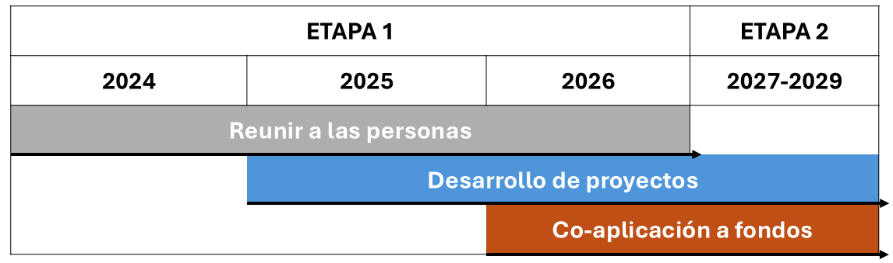
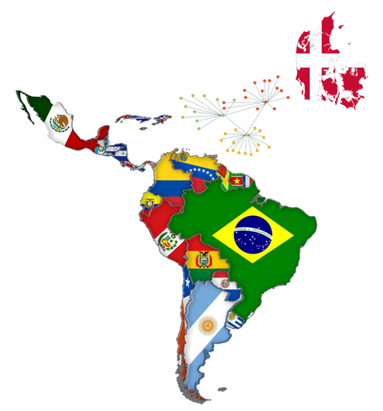

La primer etapa del proyecto de internacionalización está planeada para
implementarse en el transcurso de tres años: 2024-2026. Cada año
representa una fase del proyecto, con objetivos independientes y
actividades alineadas a ellos.

{fig-align="left"}

## Reunir a la gente

Esta fase del proyecto consiste en la realización de seminarios en línea
con el objetivo principal de crear y fortalecer la red SDCA-LATAM.
Además, queremos conocer y diseminar el tipo de investigación en
diabetes que se lleva a cabo en la región de América Latina, identificar
áreas potenciales de colaboración y conocer los intereses y necesidades
de investigación en diabetes en la región.

Desde la primavera de 2024 se han organizado estos seminarios de manera
mensual e involucrado a colegas con una gama de pérfiles diversos que se
encuentran en diferentes etapas de su trayectoría académica o clínica.
Gracias a la contribución de presentadores de diferentes países en la
región, incluyendo Argentina, México, Perú, Colombia, Costa Rica,
Ecuador y Brasil, estamos construyendo puentes al mismo tiempo que
diseminamos el conocimiento que se produce de manera local.

{fig-align="center"}

Accede a las presentaciones y las grabaciones en la pestaña de
"Seminarios".

## Desarrollo de proyectos

Conforme la red ha comenzado a tomar forma, las ideas comenzaron a
surgir y las oportunidades de colaboración a presentarse. Es por eso que
en esta fase del proyecto nos enfocamos en sentar las bases de estas
colaboraciones. Enmarcamos nuestras actividades académicas y de
investigación bajo la perspectiva de ciencia abierta y reproducibilidad.

¿Qué es la ciencia abierta? <em> "Es un concepto inclusivo que combina
diversos movimientos y prácticas con el objetivo de hacer que el
conocimiento científico multilingüe esté abiertamente disponible, sea
accesible y reutilizable para todos; de fomentar la colaboración
científica y el intercambio de información en beneficio de la ciencia y
la sociedad; y de abrir los procesos de creación, evaluación y
comunicación del conocimiento científico a actores sociales ajenos a la
comunidad científica tradicional".</em>

Bajo este marco es que ponemos manos a la obra prácticas de ciencia
abierta, tales como hacer públicamente disponible el material que se
produce durante los seminarios en línea, compartir el código y el
material que utilizamos para realizar los cursos y talleres que llevamos
a cabo y promoviendo el uso de software abierto (i.e. R, Github, etc.).

Reproducibilidad se refiere a la <em>"obtención de resultados
consistentes utilizando los mismos datos de entrada, pasos
computacionales, métodos y código, así como las mismas condiciones de
análisis".</em> En este sentido y en conexión con ciencia abierta,
también estamos interesados en colaborar realizando ciencia
reproducible, es decir que buscamos primero publicar los protocolos de
los proyectos que queremos llevar acabo en colaboración, para después
utilizar software que permita utilizar control de cambios (version
control) para posteriormente publicar los resultados en repositorios
abiertos de preprints (prepublicaciones) antes de hacerlo en revistas
arbitradas.

Nuestro primer ejemplo de colaboración abierta puede ser consultado
aquí: [Incidencia de diabetes en
Perú](https://github.com/Incidence-of-diabetes-LATAM/Incidence-Peru)

## Co-aplicación a fondos

A lo largo de estos tres años hemos sometido tres propuestas de
financiamiento. Dos a la Fundación Novo Nordisk Global Science Summit
Programme 2024 y 2026 primero con el proyecto LatinDiab-1, y luego con
LatinDiab, en donde ampliamos el enfoque a diabetes en general. La
segunda aplicación sometida fue al Global Innovation Network Programme
de la Agencia de Educación Superior de Dinamarca, con el objetivo de
conformar una red de instituciones en Dinamarca, México, Colombia, Perú
y la Asociación Latinoamericana de Diabetes.

A pesar de no haber conseguido estos fondos, estos esfuerzos nos han
permitido fortalecer nuestros vínculos y refinar nuestras ideas de
proyectos. Pueden consultar los pdfs de las aplicaciones en la pestaña
"Más recursos"

## Otras actividades e iniciativas en la red

Promovemos el establecimiento de equipos de trabajo a manera de
colaboraciones de escritura bajo tres temas, diabetes tipo 1, prevención
de diabetes tipo 2 y complicaciones de diabetes tipo 2. Actualmente
existe uno de estos equipos está desarrollando un proyecto sobre
aislamiento social y prevalencia de diabetes utilizando datos de
Ecuador.

También hemos contribuido con cursos presenciales en México, Argentina y
Perú. El material de estos cursos puede ser consultado en la pestaña
"Más recursos".

## El camino a seguir 2027-2029

En esta nueva fase del proyecto tenemos la meta de evolucionar de una
red a convertirnos en una comunidad que acciona en la diabetes a partir
de actividades académicas y de investigación. Las actividades que vamos
a implementar buscan motivar y/o fortalecer el sentido de pertenencia,
el valor de pertencer a esta comunidad, la confianza y colaboración
entre los miembros.

Nuestra ambición es poner en marcha proyectos reproducibles, de alta
calidad y rigor científico, que sigan los principios de ciencia abierta.
Actualmente estamos trabajando en esta estrategia y diseñando las
actividades que nos ayudarán a convertinos en esta comunidad.

```{=html}
<!-- 
- Los seminarios en línea van a continuar con una frecuencia trimestral
  o a demanda. Es decir que queremos seguir promoviendo este espacio
  virtual de difusión sincrónica pero ahora a demanda, es decir, que
  este espacio estará a disposición de la red para presentar los
  resultados de sus estudios o recibir retroalimentación sobre sus
  proyectos o ideas actuales. (respetando los días-Miércoles- y horarios
  establecidos (depende de la zona horaria).

- News letter. Otra manera de conocer mejor el trabajo y las ambiciones
  de los miembros de la red, es mediante un news letter. El contenido
  del newsletter y la frecuencia con que se distribuya está abierto a
  discusión y definición. Queremos co-diseñar las actividades de la
  siguiente fase del proyecto, por eso que se invulcren es importante
  para fortalecer nuestros vínculos!

- Grupo de estudio sobre GitHub. Queremos promover el uso de
  herramientas de libre acceso que permitan prácticas modernas de
  colaboración como el uso de sistemas de control de cambios. Existe
  mucho material disponible en la red sobre su uso, por lo que diseñar
  un curso es poco eficaz para el próposito de establecer proyectos
  colaborativos utilizando este tipo de herramientas. Un grupo de
  estudio consise en participantes que revisan material didáctico de
  manera independiente y asincrónica, luego coincide con un grupo de
  otros participantes para discutir de manera grupal el proceso de
  implementación del flujo de trabajo. Una vez estudiado y establecido
  este flujo de trabajo, se ejecutará un proyecto en grupos utilizando
  datos de libre acceso (ENSAEM, ENSANUT, ELSA, ENSA de Perú) y las
  herramientas para elaborar un proyecto sobre diabetes con un flujo de
  trabajo reproducible.

- Colaboraciones de escritura.

- Co-aplicación a fondos. -->
```
